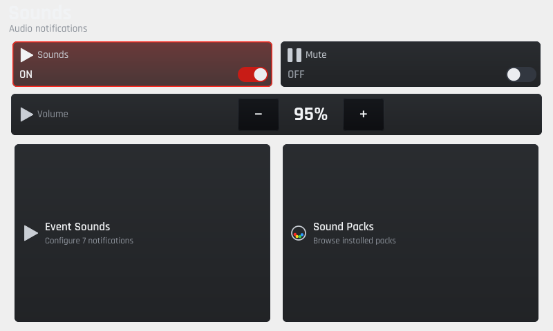
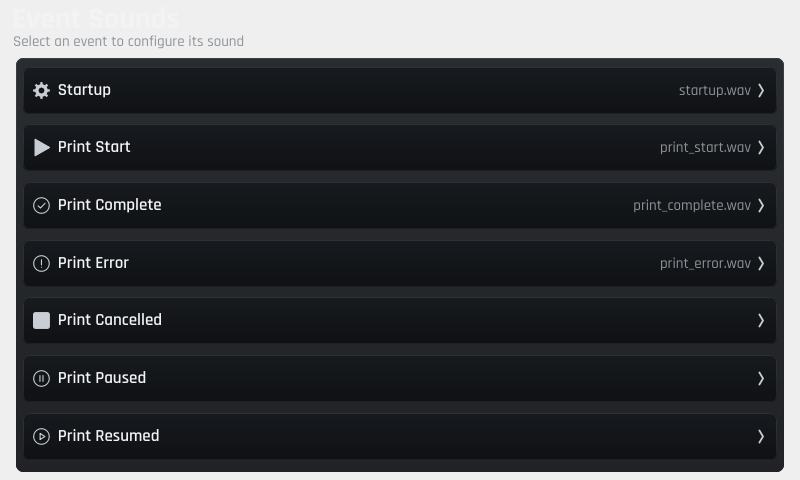
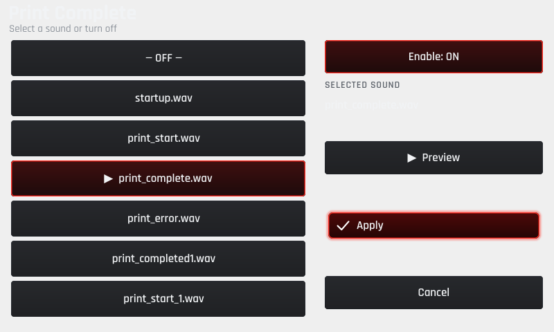
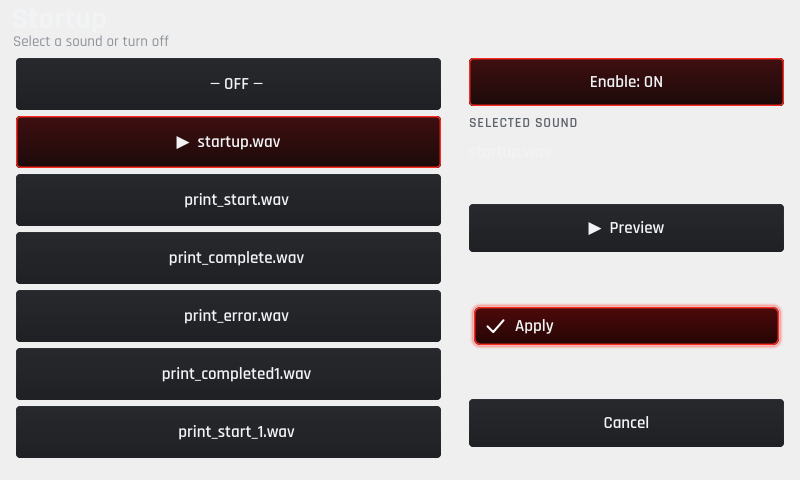

# Nexus Sounds

> Audio notification addon for [Nexus Screen](https://github.com/TheOmProject/Nexus-Screen).

**Status: Released — v0.1.4**

Nexus Sounds is an **optional addon** for Nexus Screen that plays notification sounds for Klipper 3D printer events: startup, print start, print complete, and print error. It runs as an independent Python daemon that connects to Moonraker via WebSocket and is configured from **Settings → Sounds** inside Nexus Screen.

---

## Screenshots

> All screenshots are captured from the real Nexus Screen UI at 800×480 (production resolution).

### Sounds Settings



Main settings screen: **Sounds ON/OFF** toggle, **Mute** toggle, **Volume** control (± buttons, current level displayed), and navigation tiles for **Event Sounds** and **Sound Packs**.

### Event Sounds



Tap any event to change its sound. Events with assigned sounds show the filename on the right.

### Sound Selection



Sound picker for a single event. The left column shows all available sounds (built-in pack + custom WAV files from `packs/custom/`). The custom files `print_completed1.wav` and `print_start_1.wav` appear automatically with no restart required. Tap a sound to select it, then **Preview** to hear it, and **Apply** to save.

### Sound Preview



---

## Installation

### Option A — Unified Bootstrap (recommended)

Install Nexus Screen and Nexus Sounds together in one command:

```bash
bash <(curl -fsSL https://raw.githubusercontent.com/TheOmProject/Nexus-Screen/main/deploy/bootstrap.sh) --with-sounds
```

Or install all three addons at once:

```bash
bash <(curl -fsSL https://raw.githubusercontent.com/TheOmProject/Nexus-Screen/main/deploy/bootstrap.sh) --with-sounds --with-video
```

### Option B — Standalone (Nexus Screen already installed)

```bash
git clone https://github.com/TheOmProject/Nexus-Sounds.git ~/nexus-sounds
bash ~/nexus-sounds/deploy/public-install.sh
```

The installer:
- Installs the `nexus-sounds` Python package
- Creates and enables the `nexus-sounds` user-mode systemd service
- Writes a default `config.json` (preserving any existing one on updates)

---

## Requirements

| Requirement | Minimum |
|---|---|
| **Nexus Screen** | v0.2.0-beta.5 or later |
| **SBC** | Raspberry Pi 4 or BigTreeTech CB1, 64-bit (aarch64) |
| **OS** | Debian 12 (Bookworm), 64-bit |
| **Python** | 3.9+ |
| **aplay** | `sudo apt install alsa-utils` |
| **websockets** | `sudo apt install python3-websockets` |
| **Audio device** | USB or onboard audio device visible to ALSA |

---

## What It Does

- Plays WAV notification sounds for printer events via ALSA (`aplay`)
- Runs as a systemd user service alongside Nexus Screen
- Configurable from **Settings → Sounds** in Nexus Screen (no manual file editing required)
- Supports custom WAV sound packs
- Settings bridge: Nexus Screen reads/writes config without introducing a Qt dependency in the daemon

---

## Custom Sounds

Drop any `.wav` file into `~/nexus-sounds/packs/custom/` and it will appear in **Settings → Sounds → Custom Sounds** automatically — no restart, no config change, no manifest required.

```
~/nexus-sounds/packs/custom/
  my_startup.wav        ← appears in Nexus Screen immediately
  print_done_chime.wav  ← appears in Nexus Screen immediately
```

The `packs/custom/` directory is never modified by updates.

### Assigning Custom Sounds to Events

1. Open **Settings → Sounds** on the Nexus Screen touchscreen.
2. Select an event (Startup, Print Start, Print Complete, Print Error).
3. Tap a sound to preview it, then tap **Assign** to save.

### Built-in Sound Packs

| Pack ID | Description |
|---|---|
| `default` | Minimal system beeps (ships with Nexus Sounds) |
| `chimes` | Soft chime set |

---

## Service Management

Nexus Sounds runs as a **user-mode** systemd service:

```bash
# Status
systemctl --user status nexus-sounds

# Start / stop
systemctl --user start nexus-sounds
systemctl --user stop nexus-sounds

# View logs
journalctl --user -u nexus-sounds -f
```

---

## Moonraker Update Manager

Add this block to `~/printer_data/config/moonraker.conf` (the bootstrap installer does this automatically):

```ini
[update_manager nexus-sounds]
type: git_repo
path: ~/nexus-sounds
origin: https://github.com/TheOmProject/Nexus-Sounds.git
primary_branch: main
is_system_service: False
managed_services: nexus-sounds
```

---

## Architecture

See [docs/ARCHITECTURE.md](docs/ARCHITECTURE.md).

---

## License

GNU General Public License v3.0 — see [LICENSE](LICENSE).
